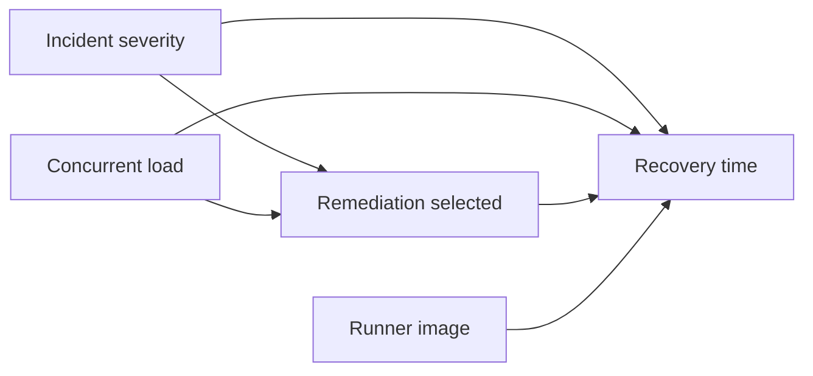

# EDAS v2.0: epistemic, decision and assurance specification

Status: **design with a tested synthetic reference subset**, 2026-10-31.
No institutional affiliation, certification, formal verification or production readiness is claimed.
The implementation and its limitations are in [the engineering evidence report](ENGINEERING_EVIDENCE_REPORT.md).

## 1. Critical assessment of Claim → Evidence → Verification → Decision

The original framework correctly demands evidence, separates confidence from fact and preserves
decision rights. Its linear form hides five consequential weaknesses:

1. **Undefined propositions.** Without scope, population, time, operational definitions and a
   counterexample, a claim can shift after every observation. Require a versioned proposition,
   competing hypotheses and a falsifier before investigation. Some normative preferences cannot
   be falsified; record them as values, not empirical hypotheses.
2. **Ambiguous verification.** A valid checksum, authentic document, correct measurement,
   supported interpretation and justified causal conclusion are different achievements.
   Record each separately. Verification can fail or remain unresolved; it never creates certainty.
3. **Unmodeled dependence and missingness.** Ten copies of one report are one lineage.
   Availability is not representativeness. Track dependencies, sampling and unobserved cases;
   disagreement and absence remain visible rather than being converted into votes.
4. **No explicit decision calculus or authority.** Believing a hypothesis and choosing an action
   have different thresholds. Record asymmetric losses, alternatives, verification cost,
   reversibility, deadline, affected parties and the person authorized to accept residual risk.
5. **No revision or stopping contract.** An investigation can become an endless search for
   confirmation; an approved decision can outlive its evidence. Precommit stop rules and review
   triggers. New material evidence invalidates affected approvals and starts a new revision.

Emotion is meaningful evidence about a person's experience and values. It is not by itself
evidence about an external actor's conduct. Observation can be accurate while its interpretation
is mistaken. Suspicion never becomes proof by repetition or by entering an audit record.

## 2. Epistemic architecture specification

```text
Question + values + domain + decision owner
  → scoped claim + alternatives + falsification conditions
  → observation acquisition + provenance + dependency graph
  → separate integrity, authenticity, relevance and measurement checks
  → competing-hypothesis assessment + uncertainty + counterevidence
  → risk and information-value review
  → authorized advisory decision + limitations + review trigger
  → observe outcomes → revise or reopen
```

Governance, privacy and an audit trail apply throughout. Epistemic status and workflow status
are separate: `UNKNOWN`, `PROVISIONALLY_SUPPORTED`, `CONTESTED`, `REFUTED_WITHIN_SCOPE` describe
claims; `OPEN`, `READY`, `REVIEW`, `DECIDED`, `REOPENED`, `UNRESOLVED` describe workflow.
`DECIDED` means an authorized choice was recorded, not that a hypothesis was proven true.
The prototype implements workflow states only; it does not assign truth labels.

| Record | Required content in the full design | Interpretation rule |
| --- | --- | --- |
| Claim | ID/version, proposition, scope, relevant date, alternatives, falsifier, owner, affected parties | Changing scope creates a revision |
| Observation | Raw measurement or exact excerpt, instrument/procedure, units, sample frame, time, missing values | Keep observations distinct from explanations |
| Interpretation | Hypothesis linkage, support/contradiction/neutral, analyst, rationale, alternative explanations | Analyst inference is not a new independent observation |
| Source | Identity, competence for this claim, incentives, access, track record, original source and dependence group | No universal prestige or reliability score |
| Evidence | Immutable content reference/hash, collector, acquisition time/method, transformations, upstream refs, access classification | Hash integrity establishes byte consistency only |
| Verification | Criterion, method/version, inputs, expected outcome, actual output, verifier, limitations | `PASS`, `FAIL`, `NOT_RUN`, `UNAVAILABLE`, `CONTESTED` stay distinct |
| Assessment | Hypotheses, assumptions, conflicting evidence, unresolved gaps, confidence rationale | Separate justified probability from qualitative uncertainty |
| Decision | Alternatives, losses, authority, evidence/policy versions, scope, expiry, reversal procedure | Approval cannot waive a failed integrity boundary |

Source independence must be assessed at the underlying observation and collection-process
level, not by counting websites, models, people or institutional names. Two methods can share
an instrument defect or dataset. Explicit dependence groups are a conservative approximation,
not proof of independence. Duplicate content should retain lineage rather than gaining weight.

Evidence quality is multidimensional: authenticity, integrity, relevance, timeliness,
completeness, measurement validity and representativeness. A primary source can be wrong.
Reliability is claim- and context-specific. A missing log may reflect retention, collection
failure, access limits or nonoccurrence; it supports a conclusion about nonoccurrence only
when the observation process was known to be sensitive and complete enough.

Before investigating, define what would change the assessment and search for it. Maintain a
counterevidence column, a sampling ledger including excluded/failed acquisitions, and an
alternative-hypothesis checklist. For consequential cases, use a reviewer who did not collect
or select the evidence. Blind labels when feasible, predefine outcomes and correct for
multiple searches. Stop expanding the claim to rescue a favored explanation.

Unrelated events are not linked by temporal proximity, emotional salience, similarity or a
shared person alone. Require a specified mechanism, testable predictions, appropriate controls
and checks for chance, common causes and selective attention. If these are absent, label the
connection unsupported and leave it unresolved. Do not investigate a person based on that
unsupported link or interpret lack of evidence as concealment.

Confidence should be an explicit rationale or an empirically calibrated forecast tied to a
defined outcome and horizon. Record predictions before outcomes. Evaluate calibration and
discrimination on held-out cases. Inter-rater agreement is not truth; repeated consensus is
not calibration. A heuristic score must be labeled heuristic. The reference implementation
does not estimate confidence from prose or source prestige.

## 3. Hypothesis evaluation protocol

1. State the question, decision, scope and observation process. Include plausible alternatives
   and an `other/model-misspecified` possibility. Do not force mutually exclusive labels onto
   events that can coexist; use a joint model or qualitative comparison instead.
2. Identify predictions each hypothesis makes and an observation that would distinguish them.
   Separate training, investigation and evaluation data.
3. State prior assumptions and their basis: relevant base rates, previous experiments or an
   explicit sensitivity range. An illustrative prior is not a measured probability.
4. Specify likelihoods **P(observation | hypothesis)**, conditional on selection and measurement.
   Do not reverse them into P(hypothesis | observation). A likelihood ratio compares how
   expected the same observation is under two hypotheses.
5. Update using Bayes only if the model and numbers are defensible. Use conditional likelihoods
   for dependent observations; multiplying marginal likelihood ratios double-counts evidence.
6. Check sensitivity to priors, missing data, unmodeled alternatives and measurement error.
   Retain contradictions and predictions not met. Record qualitative conclusions when numbers
   would imply unsupported precision.
7. Hand the assessment and uncertainty to the decision owner. An elevated posterior does not
   authorize accusation, payment, diagnosis or irreversible action.

**Worked Bayesian example (entirely synthetic).** Suppose the only two hypotheses in a toy
model are regression R and transient runner failure T. Set P(R)=0.10 and P(T)=0.90 for
illustration. For repeated failure E under a specified reproduction procedure, suppose
P(E|R)=0.80 and P(E|T)=0.10. The likelihood ratio is 8. Prior odds are 1:9; posterior odds
are 8:9, so P(R|E)=8/17 ≈ 0.471. The procedure changes the belief, but does not establish
a regression. A copy of the same log supplies no second likelihood ratio.

Sensitivity matters: with P(R)=0.01, the same likelihoods produce 0.008/0.107 ≈ 0.075;
with P(R)=0.50 they produce 0.40/0.45 ≈ 0.889. These are conditional arithmetic examples,
not plausible operational estimates. Real estimates require independently labeled incident
data and validation of the reproduction process. `posterior` implements one supplied update;
it does not check the scientific validity of its input model or calculate sequential updates.

**Worked qualitative example.** Two builds fail after a dependency update. Candidate
explanations include a dependency regression, a runner-image change and a transient outage.
No relevant incident corpus or reliable likelihoods are available. Do not invent probabilities.
Record the update as an observation, inspect lockfile and runner changes, and compare pinned
old/new dependency versions on matched runners. Leave attribution unresolved if both changed.

Aleatory variability (e.g. observed run-to-run noise), finite-sample statistical uncertainty,
and epistemic gaps (unknown collection process, absent data or wrong model) require different
treatment. A narrow confidence interval addresses none of the last category. Bayesian
calculations are inappropriate when unsupported likelihoods, unstable selection, ambiguous
hypotheses or unobservable outcomes would make their precision misleading. Use bounds,
scenario analysis, partial identification or qualitative assessment instead.

**Causal example.** Before/after association can be confounded:



The diagram states candidate assumptions, not discovered causal facts. Define the estimand
(e.g. average effect of assigning this remediation on recovery time in eligible synthetic
incidents). Randomize eligible matched incidents to policies, keep runner/load fixed or
blocked, measure compliance and interference, and compare intention-to-treat outcomes.
Without randomization, justify identification assumptions, measured confounders, overlap and
selection mechanisms; otherwise report association only. Do not condition indiscriminately
on post-treatment variables or colliders. A DAG alone proves neither identification nor effect.

## 4. Decision policy specification

Choose an authorized action from explicit alternatives. When defensible distributions exist,
minimize expected loss `sum_h P(h|E) L(action,h)` subject to hard constraints, decision rights
and resources. Include inaction and delay. Do not force money-valued estimates on dignity,
consent, health or legal rights. Use ordinal consequence classes and robust choices across
plausible models when probabilities or utility tradeoffs are not defensible.

For binary action/inaction with zero loss on correct choices, acting incurs C_FP if the event
is absent and inaction incurs C_FN if present. Act when
`p > C_FP / (C_FP + C_FN)`, only under these assumptions and within authority. Different
false-positive and false-negative costs produce different thresholds; belief alone cannot
set a universal threshold. With hypothetical C_FP=1 and C_FN=99, the threshold is 0.01.
This illustrates why low-cost reversible protection can be justified before proof. It does
not justify a high-impact allegation or action against another person.

The expected value of sample information is current minimum expected loss minus expected
minimum loss after a proposed observation, before test cost. Investigate when this improvement
exceeds collection cost, delay harm and privacy burden, with enough time and authority to use
the result. Perfect-information value is an upper bound, not a justification to collect
everything. In uncertain models, test whether the result could change the preferred action;
if not, further verification usually has little decision value.

| Situation | Required behavior | Stop/escalation rule |
| --- | --- | --- |
| Credible immediate safety hazard | Proportionate reversible protection and contact the appropriate responsible professional/service | Do not wait for complete proof; do not infer wrongdoing |
| Low-impact reversible choice with sufficient relevant checks | Offer bounded action with monitoring; owner decides | Expiry, observable rollback trigger and scoped permission |
| Missing or invalid evidence | Investigate only if useful and proportionate; never mark verified | Deadline/cost/attempt cap leads to `UNRESOLVED` |
| Material contradiction or sensitive/irreversible consequence | Preserve both sides and route to qualified independent human review | No automated high-impact authorization |
| Medical/legal/financial consequence beyond competence | Seek the appropriate licensed/qualified professional with minimum necessary evidence | Tool does not replace judgment, diagnosis or legal standards |
| Cost exceeds benefit or no discriminating test available | Deliberately defer with reason, owner and review date | Unresolved is a legitimate outcome |
| Suspected integrity failure | Quarantine affected evidence/decisions and reacquire from trusted source | Do not retry blindly or treat tampering as proof of the underlying allegation |

Precommit maximum attempts, cost, elapsed time, no-progress threshold and review authority.
Repeated independent new observations can justify reopening; repetition of the same allegation
cannot. Exceptions must be scoped, authorized, expiring and visible; they cannot override
integrity checks or consent. The prototype uses illustrative caps, not domain risk thresholds.

## 5. Assurance specification and test plan

The reference transitions are:

| Operation | Preconditions | Postcondition |
| --- | --- | --- |
| Register | Unique claim, alternatives, falsifier, synthetic owner, finite deadline | `OPEN`, revision 0, audit event |
| Add evidence | Existing case, owner, unique ID, matching digest | Revision advances; approval cleared; decided/unresolved becomes `REOPENED`, otherwise `OPEN` |
| Evaluate | Finite cost/clock, nondecreasing logical time, not `DECIDED` | `OPEN`, `READY`, `REVIEW` or `UNRESOLVED`; no external effect |
| Approve advice | `READY`, different reviewer ID, current revision/policy, fresh evidence, before deadline | `DECIDED`, revision advances, reviewer recorded |
| New evidence after decision | Same evidence checks as above | Old advice invalidated; assess contradiction at the next evaluation |

Within evaluation, immediate-hazard advice precedes budgets; budget/deadline refusal precedes
ordinary assessment; contradiction/severe/irreversible cases precede eligibility. No automated
operation approves a high-risk case. `REVIEW` cases require external judgment; the example
has no force-approve endpoint. `UNRESOLVED` is stable until evidence arrives; cost/attempt
usage is retained so resubmission does not reset the budget. No evidence input executes code.

Invariants intended and empirically tested in the reference:

- No `READY` state from absent, stale, future, unattested, contradictory or dependent-only evidence.
- No `DECIDED` state without a current, distinct reviewer ID and fresh evidence.
- New evidence clears prior approval, even when it agrees with the previous conclusion.
- Invalid mutation does not change the case or audit tip; spending/attempts do not exceed caps.
- Time cannot move backwards; deadline equality blocks ordinary approval.
- Audit order, hash linkage and content are checked against an externally retained expected tip.
- Privacy defaults keep claim prose and evidence payload out of audit events. Every demo artifact
  contains synthetic data only. Pattern rejection is defense in depth, not comprehensive DLP.

The event schema records sequence, case ID, revision, action, state, actor ID, policy version,
context hash, prior hash and event hash. The context hash binds the case and evidence metadata,
including payload hashes. Full production design must additionally record trusted wall-clock
time, request and decision IDs, authenticated role/authority, policy digest, schema version,
reason codes, source references and trusted checkpoint/signature metadata. Log minimization
must coexist with authorized reproducibility of retained evidence.

The example's hash chain detects mutation, reordering and truncation **only relative to a
separately trusted tip**. It does not authenticate sources, establish collection completeness,
survive arbitrary privileged rewriting, or protect confidentiality. Caller-supplied attestations,
source groups and reviewer names are not validated identities. In-memory Python objects are
not a security isolation boundary. Restart loses all state. No formal proof artifact exists.

Recovery design for a durable implementation: fail closed on log/state mismatch; stop actions,
compare against a trusted checkpoint, quarantine corrupt records, replay a validated prefix in
a recovery transaction, invalidate derived approvals, and require reconciliation by a human.
Never erase contradictory events. Restore tests must verify RPO/RTO targets, missing-tail
detection and crash consistency. External side effects require idempotency keys, a transactional
outbox and reconciliation of unknown results; retry cannot turn an unknown payment/push into
another attempt without checking its identity. The MVP has no external effects to roll back.

Testing layers: regression tests for discovered CI defects; adversarial evidence and approval
tests; boundary tests at expiry/cost/attempt limits; bounded exhaustive enumeration of 32
control combinations. Randomized property-based stateful testing and model checking are
**proposed**, not executed. Tests support bounded empirical assurance, not mathematical proof.
Formal assurance would require a specified transition system, explicit environmental assumptions,
machine-checkable properties, proof/model-checker artifacts and implementation refinement.

## 6. Governance and assurance matrix

Domain profiles are mandatory. Personal preference choices can accept qualitative evidence and
one-person decisions. IT audit requires engagement scope, criteria, evidence sufficiency and
independent professional judgment. Financial controls need transaction authorization, reconciliation,
segregation and applicable retention. AI governance needs intended-use boundaries, impacted
stakeholders, dataset/model versions and ongoing monitoring. SRE emergency powers need incident
command, change scope and post-incident review. Research needs preregistration, ethics and valid
inference. These are related controls, not equivalent legal or evidentiary standards.

| Control | Accountable role | Evidence / independent review | Current status |
| --- | --- | --- | --- |
| Scope, values, risk appetite, domain profile | Decision owner + domain specialist | Approved policy and authority register; affected-party input | Designed; demo parameters only |
| Acquisition and provenance | Evidence custodian | Collection procedure, lineage, integrity checks, completeness reconciliation | Digest/metadata subset tested; authentic acquisition unimplemented |
| Hypotheses and inference | Analyst | Alternatives, falsifiers, missingness, documented assumptions | Required fields and toy arithmetic tested; scientific validity not automated |
| Consequential decision | Authorized decision owner | Current evidence snapshot and qualified independent review | Distinct-name check tested; real IAM unimplemented |
| Conflict of interest | Governance owner | Disclosure, reviewer recusal, independent reviewer assignment | Designed only |
| Policy change | Policy owner + independent reviewer | Version/diff, regression results, signed approval and effective date | Version matching tested; release workflow proposed |
| Exception management | Named risk acceptor | Reason, scope, expiry, compensating controls, periodic review | Designed only; no override in MVP |
| Privacy and retention | Data steward + privacy/legal specialist | Minimal data map, access logs, deletion and hold schedules | Synthetic-only inputs tested; no regulated-record lifecycle |
| Control effectiveness | Independent assurance reviewer | Sample completeness and operating effectiveness over time | No independent assurance performed |
| Continuous improvement | Maintainer + governance owner | Incident learning, error taxonomy, evaluation drift and regression history | Local test evidence; no operational longitudinal study |

**Source verification, 2026-10-31.** Primary public pages were retrieved using Exa. NIST's
[AI RMF page](https://www.nist.gov/itl/ai-risk-management-framework) and
[Core](https://airc.nist.gov/airmf-resources/airmf/5-sec-core/) identify AI RMF 1.0, note an
update in progress and describe GOVERN, MAP, MEASURE and MANAGE as iterative functions, with
governance cross-cutting. EDAS roles/policies map conceptually to GOVERN; context/causal scope
to MAP; evaluations to MEASURE; escalation/monitoring to MANAGE. This is design alignment,
not a completed assessment against categories or subcategories.

[ISO's ISO 31000 page](https://www.iso.org/standard/65694.html) identifies ISO 31000:2018,
reviewed/confirmed in 2023, and describes identifying, analyzing, evaluating, treating,
monitoring and communicating risk. It explicitly says the guideline is not certifiable.
EDAS covers these activities conceptually; the licensed full text was not reviewed, so there
is no clause-level conformity claim.

[COSO's Internal Control page](https://www.coso.org/internal-control) identifies the 2013
refresh of its integrated framework and lists 2026 generative-AI supplemental guidance.
EDAS accountability, authorization, evidence quality and independent monitoring are compatible
control objectives. The full framework and 2026 supplement were not inspected; no assertion
of coverage of all principles, operating effectiveness or financial-reporting assurance is made.
Recheck these sources when adopting a profile; a conceptual crosswalk is not compliance evidence.
