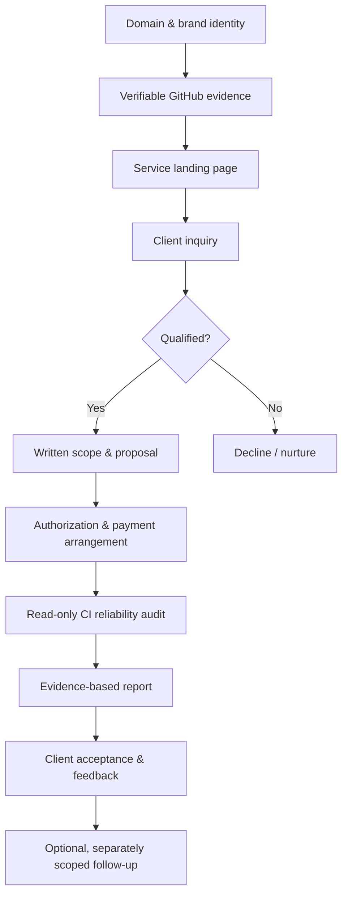

# Kozphy Business Playbook: Domain → GitHub Evidence → Service Page → Client Inquiry → Paid Pilot

> **Status:** Implementation playbook / hypotheses to validate  
> **Date:** 2026-11-07  
> **Version:** 1.0  
> **Brand:** Kozphy — Engineering Reliability & Auditable Automation  
> **Pilot offer:** GitHub CI Reliability Audit, **US$149 for the first 3 clients** (as currently stated in this repository's README).  
> **Publication note:** This is a business plan, **not evidence of existing customers, revenue, verified domain ownership, or an incorporated company**.

## Objective

Build a repeatable, low-cost route from demonstrable engineering capabilities to a first paying customer:



**Hypothesis:** Small engineering teams using GitHub Actions will pay for a bounded, evidence-based diagnosis of recurring CI failures. Validate with actual prospects; a website and repo stars alone do not demonstrate demand.

## 1. Positioning and customer

**Suggested tagline:** *Turn engineering failures into verifiable evidence and actionable improvements.*

Start with small SaaS teams, independent maintainers, and AI startups using GitHub Actions. Qualify on real CI pain, authority to approve a review, willingness to pay, and permission to access in-scope materials. Avoid enterprise promises that require security controls or procurement readiness not yet established.

**Lead offer:** **GitHub CI Reliability Audit — US$149 introductory pilot**.

This repository's current [README](../../README.md) describes a **fixed-price, read-only, one-repository audit with a three-business-day report target**. The final deadline must be agreed in writing and conditioned on receipt of complete authorized inputs. Do not silently change the price, duration, or inclusions in marketing copy.

The initial deliverable should be a documented review of agreed GitHub Actions workflow(s), available run history, recurring failure patterns, and prioritized recommendations. No guaranteed repairs, ongoing monitoring, production changes, penetration testing, or unlimited debugging.

## 2. Domain identity

An owned domain is useful for continuity and trust, but **does not establish incorporation or qualify the owner for financial-service onboarding**.

Suggested, **not availability-verified**, names: `kozphy.com`, `kozphy.dev`.

Low-cost architecture:

| Layer | Option | Verification needed |
| --- | --- | --- |
| Domain/DNS | Cloudflare Registrar | Checkout price, renewal rate and access control |
| Website | GitHub Pages or Cloudflare Pages | Live site, HTTPS and mobile behavior |
| Business email | Eligible mail provider or domain forwarding | Inbound/outbound sending, regional plan availability |
| Source/evidence | GitHub | Public, reproducible and sanitized proof |
| Inquiry | Privacy-aware hosted form | Spam protection, delivery and data retention |

Candidate aliases: `contact@`, `dev@`, `ops@` on the **domain actually purchased**. Aliases may share an inbox and are not necessarily free separate mailboxes. Configure MFA, SPF, DKIM and DMARC as applicable. Never claim a domain or inbox is live before testing it.

## 3. GitHub evidence: claim → evidence → verification → decision

Primary technical evidence: [Kozphy/ci-failure-orchestrator](https://github.com/Kozphy/ci-failure-orchestrator). Related projects (e.g., EvalForge and FinOps) can support future, **separately scoped** services after verification.

The README describes classification, policy gates, worktree verification, CI evidence and reports. **Those are repository claims until reproduced on a specific release; do not turn them into measured customer outcomes without proof.**

| Commercial claim | Minimum proof | Decision rule |
| --- | --- | --- |
| Diagnose CI failure | Demo/log plus referenced source and test | Publish only if independently repeatable |
| Classify failure causes | Labeled cases and evaluation method | State sample size and limitations |
| Reject unsafe repair | Negative tests for skipped/deleted tests and weakened gates | Don't imply impossible to bypass |
| Review failure history | Dated, sanitized input and sample report | Explain sampling and missing data |
| Deliver actionable recommendations | Example findings and ranked fixes | No fabricated savings or testimonials |

Recommended evidence manifest: `docs/evidence-manifest.md` (create after actual verification).

```yaml
project: ci-failure-orchestrator
release: "<verified commit or tag>"
claim: "<one narrow claim>"
source: "<relative source path>"
test: "<relative test path>"
reproduce: "<exact command>"
environment: "<runtime and dependencies>"
status: "verified | partial | unverified"
limitations:
  - "<known constraint>"
```

**Before publication:** reproduce the demo, inspect tests, publish a sanitized example audit, label experimental functions, and verify links. Never expose secrets, tokens, customer logs or private metadata.

## 4. Service page

Suggested paths on the final website:

```text
/
├── services/ci-reliability-audit/
├── evidence/
├── about/
├── contact/
└── privacy/
```

**Headline:** Stop Guessing Why Your CI Pipeline Fails.

**Subheadline:** An evidence-based review of your GitHub Actions workflows, recurring failure patterns and prioritized reliability improvements.

**Offer:** One agreed repository; read-only CI review; written findings, evidence references, recommendations and limitations; introductory **US$149** for first three clients; target **3 business days once authorized inputs are complete**, subject to the written agreement.

**CTA:** Request a CI Reliability Audit. Route to qualification and a proposal **before** requesting payment or privileged access.

Display only verified demo screenshots, sample reports and source links. Do not represent internal experiments as paying-client case studies.

## 5. Inquiry and qualification

Ask only for: name, reply-to email, business/product website (optional), public repo link (optional), CI platform, brief pain description, frequency/impact, and contact consent. Never request passwords, private logs or access tokens through a public form. Publish privacy purpose, retention and deletion/contact instructions.

Experimental lead rubric:

| Criterion | Score |
| --- | ---: |
| Active CI issue | 0–3 |
| Recurrent operational impact | 0–3 |
| Clear purchase decision-maker | 0–2 |
| Willingness to pay | 0–2 |
| **Total** | **0–10** |

8–10: prioritize discovery; 5–7: clarify; 0–4: decline/nurture. This rubric is a planning device, not a validated predictive model.

Track status: `new → qualified → discovery → proposal → accepted → paid/authorized → delivered → closed/follow-up`. Restrict access to lead data.

## 6. Paid-pilot operating procedure

1. **Discover:** Define repository, workflows, CI platform, lookback window, pain, desired decision and exclusions.
2. **Propose:** Written fee, deliverables, acceptance criteria, three-business-day *target*, customer prerequisites, revision/refund terms, and change-control process.
3. **Authorize:** Confirm the customer is permitted to share the material; agree least-privilege access, confidentiality, permitted processing, retention and deletion.
4. **Collect payment lawfully:** Verify provider eligibility and tax/invoicing requirements for the actual jurisdiction and seller status. A branded email is not a legal entity; do not assume Taiwan-based sellers can open Stripe Payments accounts.
5. **Analyze read-only:** Prefer public repos or narrowly scoped customer-provided exports; no production changes, blanket admin rights or running untrusted scripts on the operator's machine.
6. **Verify:** Cite evidence and reproducible checks; distinguish observations, hypotheses and unknowns.
7. **Deliver:** Report plus agreed limitations and an actionable priority list; obtain acceptance and collect feedback.
8. **Follow up:** Only suggest separately authorized remediation or monitoring. Never imply a recurring contract exists.

Minimum deliverables:

```text
client-deliverables/
├── executive-summary.md
├── ci-failure-analysis.md
├── evidence-manifest.md
├── recommendations.md
└── limitations.md
```

**Evidence report format:** scope and observation window; input sources; failure patterns; numerical denominator and sampling method where statistics are used; technical recommendations ranked by impact, effort and confidence; limitations; proposed next action.

## 7. Example pilot unit economics (hypothetical, not actual earnings)

- Price: US$149
- Assumed direct costs: US$15
- Assumed delivery time: 6 hours
- Contribution before founder labor, acquisition, tax and overhead: **US$134**
- Contribution per delivery hour before those additional costs: **US$22.33/hour**

Do **not** call this net profit. Track actual costs, time, unsuccessful sales effort, fees, refunds and taxes.

Funnel metrics: landing-page visitors; inquiries/visitors; qualified/inquiries; accepted proposals/proposals; paid pilots/qualified leads; cash collected; delivery hours; contribution; repeat purchases.

Initial **targets, not forecasts**: 30 researched prospects → 5 substantive responses → 3 discovery conversations → 2 proposals → 1 paid pilot.

## 8. Fourteen-day launch checklist

| Day | Work | Exit criterion |
| --- | --- | --- |
| 1 | Define ideal customer | Narrow buyer and CI pain |
| 2 | Audit repository claims | Verified vs. unverified inventory |
| 3 | Prepare sample audit | Sanitized report with traceable evidence |
| 4 | Freeze pilot scope | Inclusions, exclusions and acceptance |
| 5 | Decide domain and hosting | Actual cost and access verified |
| 6 | Build page | Responsive draft |
| 7 | Link technical proof | Source/demo links work |
| 8 | Connect inquiry form | Delivery, consent and privacy tested |
| 9 | Draft agreement | Scope, rights, security, payment, refund |
| 10 | Validate payment/tax workflow | Eligible provider and requirements verified |
| 11 | Research first 10 prospects | Specific public relevance for each |
| 12 | Research next 20 prospects | 30-prospect worksheet |
| 13 | Personalized outreach | Outreach log and follow-up policy |
| 14 | Measure and revise | Bottleneck and next experiment recorded |

No domain, checkout or legal process should be marked completed just because it is in this checklist.

## 9. Outreach template

**Subject:** Quick question about your GitHub Actions reliability

Hi [Name],

I noticed [specific, public, verifiable engineering context].

I'm building Kozphy, an independent engineering service focused on CI reliability and evidence-based failure analysis. I'm testing a fixed-scope GitHub Actions audit that identifies recurring failure patterns and produces a prioritized technical report.

Would an independent review of one repository be useful for your team?

Here is a reproducible example of my approach:  
https://github.com/Kozphy/ci-failure-orchestrator

Best,  
Kozphy

Do not invent observed failures, impersonate team members or send mass unsolicited messages.

## 10. Risk controls

| Risk | Control |
| --- | --- |
| No real demand | Conduct customer discovery; track paid conversion |
| Overstated performance | Tie claim to exact commit, test and limitation |
| Unauthorized repo access | Written authorization; least privilege; read-only first |
| Sensitive data exposure | Sanitize, minimize, secure, define retention/deletion |
| Scope creep | Signed scope and separately approved changes |
| Payment/tax incompatibility | Verify eligibility and local obligations before charging |
| Low margins | Track **all** labor and acquisition effort |
| False corporate status | Identify as brand/independent service unless legally registered |

## 11. Definition of done

- [ ] Domain and inbox owned, tested and secured
- [ ] Site accurately describes a **single** offer
- [ ] README and commercial page state consistent price, scope and timing
- [ ] Technical proof has reproducible links and explicit limitations
- [ ] Inquiry, privacy and consent flow tested
- [ ] Scope and authorization documents ready
- [ ] Eligible payment and invoicing process verified
- [ ] Audit workflow produces a deliverable without unauthorized changes
- [ ] Sales funnel and true costs tracked
- [ ] **One real customer pays and receives an accepted deliverable**

**Operating principle:** *Claim → Evidence → Verification → Decision.*

**First goal:** A customer with an actual CI reliability problem willingly pays for a correctly scoped, defensible technical review. Scale to automation, subscriptions and additional product lines only after that outcome is demonstrated.
