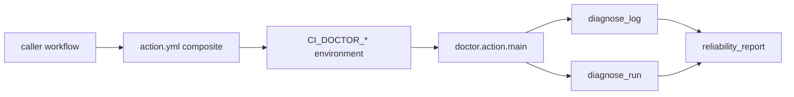

# Architecture

`diagnose_log` needs no token. `diagnose_run` uses the existing GitHub client and is unchanged aside from publishing the same report. The repair CLI is not called.

LLM analysis is not part of this path. Adding a model would spend money and would send log text to that provider. That is not enabled.

Later interfaces, not built here: an MCP server, a GitHub App, a hosted API, and EvalForge. They would call `diagnose_log` or `diagnose_run` rather than a second classifier.
