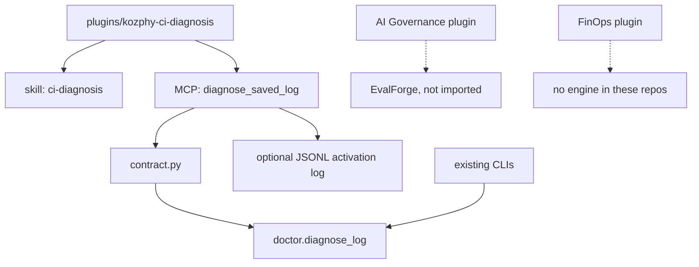

# Kozphy AI Toolkit architecture (v0.1)

The toolkit is a thin product layer over engines that already exist. This repository implements the CI slice only.

| Layer | v0.1 | Status |
| --- | --- | --- |
| Plugin package | `plugins/kozphy-ci-diagnosis` | implemented for CI diagnosis |
| Agent skill | `skills/ci-diagnosis/SKILL.md` | implemented |
| MCP adapter | one tool, stdio JSON-RPC, no SDK dependency | implemented |
| Engine | existing `diagnose_log` | reused, not rewritten |
| Validation | argument allow-list and result schema check | implemented |
| Governance plugin | would call EvalForge graders | designed, not implemented |
| FinOps plugin | would need a cost engine | designed, not implemented |

## Free and paid

Free means the MIT package: install it and call `diagnose_saved_log` locally. This plugin does not check a license server and does not record a customer.

Paid human services are the audit and repair offers already written in the repository README. Those pages still contain placeholder booking and payment links. There is no billing code in this slice, and this change does not add a measured sale.

Planned software subscriptions stay in `docs/COMMERCIALIZATION_PLAN.md`. They are not part of v0.1.

## Activation metric

`tool_completed_count` is the number of JSONL lines with `"event": "tool_completed"` in the optional `--audit-log` file. The line stores the tool name, ok, error code, and duration. It does not store the log. With the flag unset, the server writes no file, so the count is not collected. No production count exists.

## Why EvalForge is not called

EvalForge is a separate proprietary repository. Its README describes finance evaluation, not CI log diagnosis. Wiring it in before this slice has a passing local test would add a second engine and a second license. The governance plugin stays a design until that test is the starting point for a later change.
